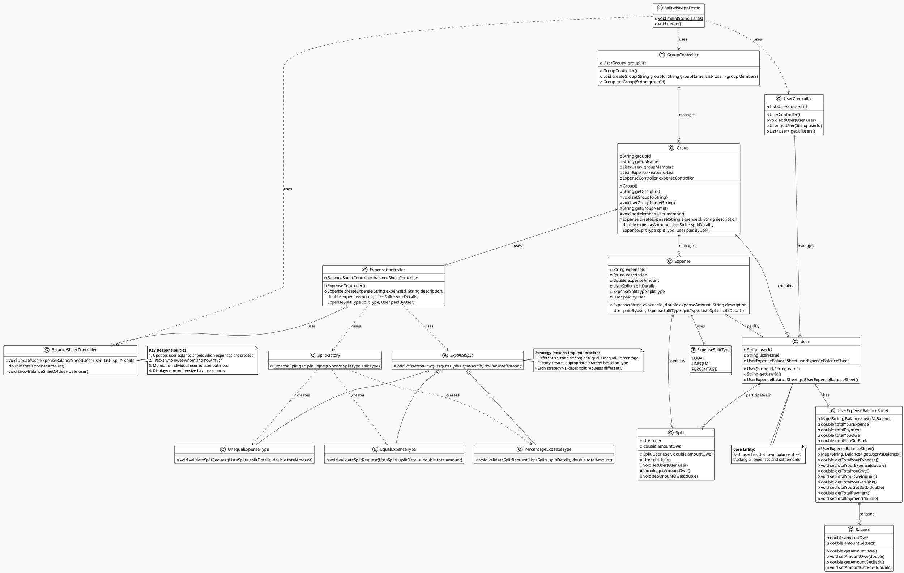

# Splitwise Application - UML Class Diagram

## Key Design Patterns Used

### 1. **Strategy Pattern**
- `ExpenseSplit` (abstract strategy)
- `EqualExpenseType`, `UnequalExpenseType`, `PercentageExpenseType` (concrete strategies)
- `SplitFactory` (factory for strategy creation)

### 2. **Factory Pattern**
- `SplitFactory` creates appropriate splitting strategy based on `ExpenseSplitType`

### 3. **MVC Pattern**
- **Model**: `User`, `Expense`, `Group`, `Balance`, `Split`
- **Controller**: `ExpenseController`, `BalanceSheetController`, `UserController`, `GroupController`
- **View**: Console output via `showBalanceSheetOfUser()`

## Core Functionality Flow

1. **User Creation**: Users are created and managed by `UserController`
2. **Group Formation**: Groups are created with multiple users via `GroupController`
3. **Expense Creation**: 
   - Group creates expense through `ExpenseController`
   - Appropriate split strategy is selected using `SplitFactory`
   - Split validation is performed
   - Balance sheets are updated via `BalanceSheetController`
4. **Balance Tracking**: 
   - Individual user balances are maintained
   - User-to-user relationships are tracked
   - Comprehensive balance reports are generated

## Key Classes Relationships

- **User ↔ UserExpenseBalanceSheet**: One-to-one composition
- **UserExpenseBalanceSheet ↔ Balance**: One-to-many (tracks balances with different users)
- **Expense ↔ Split**: One-to-many (expense is split among multiple users)
- **Group ↔ User/Expense**: One-to-many (group contains users and manages expenses)
- **Controllers**: Orchestrate business logic and coordinate between entities

This design ensures proper separation of concerns, extensibility for new split types, and maintains accurate financial tracking between users.
