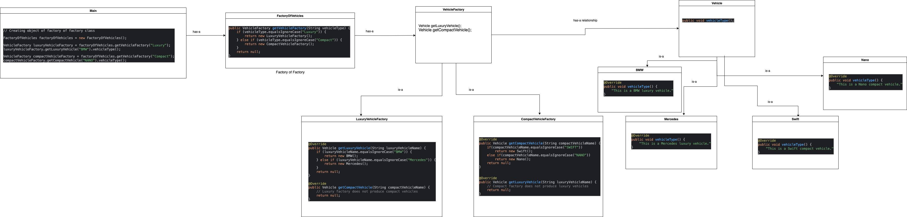

# Abstract Factory Design Pattern

This image visually represents the Abstract Factory Design Pattern. You can refer to the diagram above for a better understanding of the relationships between the Abstract Factory, Concrete Factories, and Product components.

The Abstract Factory Pattern provides an interface for creating families of related or dependent objects without specifying their concrete classes. In this example, we have:
- Abstract Factory (VehicleFactory) that declares methods for creating vehicles
- Concrete Factories (LuxuryVehicleFactory, CompactVehicleFactory) that implement the creation methods
- Abstract Product (Vehicle) that declares the interface for vehicle types
- Concrete Products (BMW, Mercedes, Swift, Nano) that implement the vehicle interface
