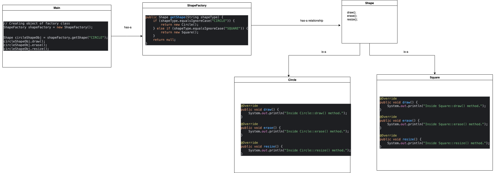

# Factory Design Pattern

This image visually represents the Factory Design Pattern. You can refer to the diagram above for a better understanding of the relationships between the Factory and Product components.

The Factory Design Pattern is a creational pattern that provides an interface for creating objects in a superclass but allows subclasses to alter the type of objects that will be created. It promotes loose coupling by eliminating the need for application code to bind directly to concrete classes.
