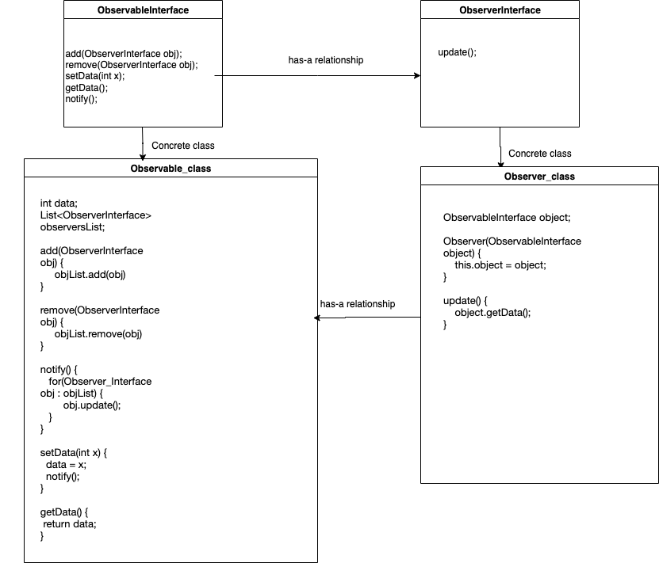

# Observer Design Pattern

This image visually represents the Observer Design Pattern. When reading about this pattern on GitHub, you can refer to the diagram above for a better understanding of the relationships between the Observable and Observer components.

