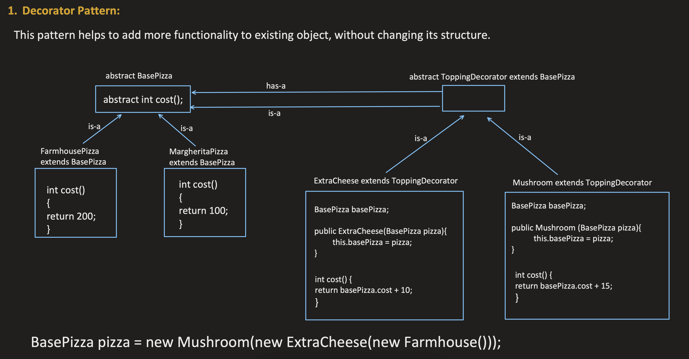

# Decorator Design Pattern

This image visually represents the Decorator Design Pattern. You can refer to the diagram above for a better understanding of the relationships between the Base class and Decorator components.
